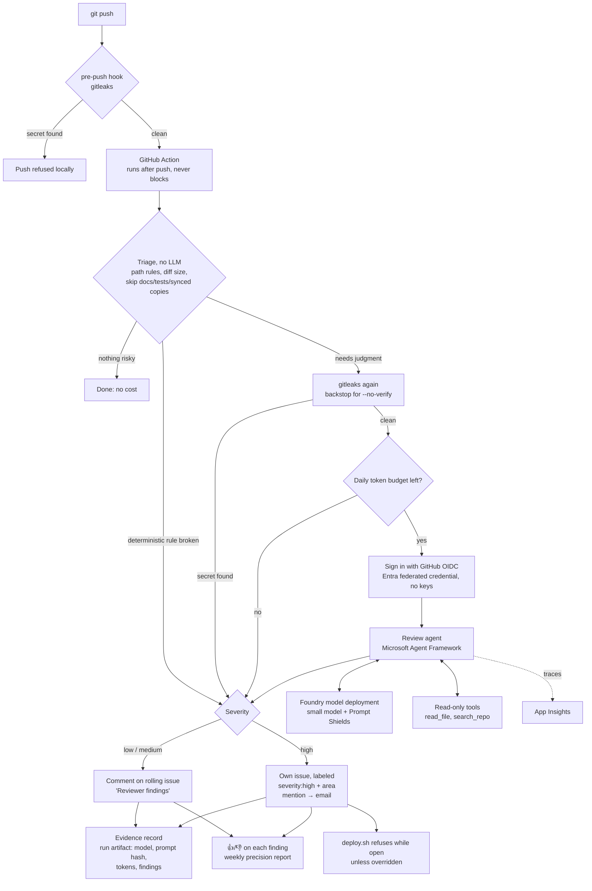

# Commit Reviewer: design

**Status:** proposed, 2026-11-17 · **Owner:** Eric Latimer

## Problem
What's Next ships about 100 commits a week across two repos (WhatsNext, whats-next-cloud), straight to the
branch with no PRs, and deploys up to ten times a day. Most mistakes are caught by tests and by the skills
Claude Code follows. The ones that get through break a repo-specific rule that no linter knows about:
editing a synced file in whats-next-cloud, adding an admin-ops action without its local mirror, or loosening
a matching rule without checking for collisions.

## Goal
A second reviewer, separate from the builder, that reads the commits that matter **after** they land and
reports anything that breaks a rule. It never slows down a commit or a push. Only a small set of high-risk
findings can hold a **deploy**, and only until they're dealt with.

**Not in scope:** blocking merges, fixing code automatically, PR workflows.

## Three checkpoints, each as strict as it needs to be

| Checkpoint | When | What it checks | Can it block? |
|---|---|---|---|
| **pre-push hook** (local, already exists in WhatsNext) | before the push leaves the Mac | gitleaks on the commits being pushed | **Yes, the push.** A secret has to be stopped here: once pushed, it's in history and has to be rotated anyway. |
| **Commit reviewer** (GitHub Action) | after the push, 1–3 minutes | triage rules + the review agent | No. It reports. |
| **Deploy gate** (`deploy.sh`) | when I deploy | any **open** issue labeled `severity:high` | **Yes, the deploy,** with an override (`REVIEWER_OVERRIDE="reason" ./deploy.sh`, logged). It doesn't wait for a review still running. |

This follows a simple rule: only block on findings that are both high-severity and high-confidence, and block
as early as the check is cheap. Everything else is advice.

## Flow

## How it works
1. **Trigger.** A workflow in each repo calls one reusable workflow in this repo, so a new repo opts in
   with about ten lines.
2. **Triage first, LLM second.** Plain code applies the repo's rules file (`.reviewer/rules.yaml`: path
   patterns, size threshold, what to skip, which area each path belongs to). Rules that can be checked
   mechanically are checked mechanically. Only diffs that need judgment reach the model, so most commits
   cost nothing.
3. **whats-next-cloud: skip synced files, not sync commits.** A sync commit can also carry cloud-native
   changes (`schema_operations.py`, `admin_ops_handlers.py`, `venue_handlers.py`, `index.py`, CDK, most of
   `scripts/`). The reviewer skips a file only if a sync wrote it: it starts with `# Synced from WhatsNext`,
   or it's listed in `WhatsNext/scripts/sync/` (synced scripts have no header). Every other changed file is
   reviewed normally. Separate deterministic check: a synced file changed in a commit that isn't a sync
   commit is a finding (someone edited the copy instead of the source).
4. **Review agent.** It gets the diff (per file, truncated), the matching sections of the repo's
   `CLAUDE.md`, and the rules that fired. It can read other files at that commit but can't change anything.
   It returns structured findings: file, line, severity, area, which rule, the claim, and its evidence.
5. **Output.**
   - **Low / medium:** one comment per reviewed commit on a single rolling issue ("Reviewer findings").
     Each finding starts with its severity and area, e.g. `🟡 medium · data-access`, so the comment reads
     like a short list. GitHub labels only work on whole issues, so per-finding areas go in the text.
   - **High:** its own issue, labeled `severity:high` plus an `area:*` label, and a mention of my GitHub
     account so GitHub emails me. Open high issues show up first in the repo's issue list, and the deploy
     gate checks them. Closing the issue (fixed or false alarm) releases the gate.
   - A JSON evidence record attached to every Action run.

## Severity and areas

**Areas** (labels and comment tags): `secrets`, `security`, `data-loss`, `schema`, `infra`, `sync`,
`admin-ops`, `matching`, `email`, `billing`, `cost`, `privacy`, `general`.

**High: holds the deploy.** Has to be looked at before the next deploy.
| Area | Example for these repos | Found by |
|---|---|---|
| secrets | API key, AWS key, DB password, OpenRouter/Gemini/Stripe key, a committed `.env` | gitleaks (deterministic) |
| security | An admin route or admin-ops action loses its admin-group check; SQL built by string formatting from request input; CORS widened to `*` | agent |
| security | A public endpoint starts returning internal fields (the public `/taplist` rows already leak some, which is why the MCP server allow-lists its output) | agent |
| infra | CDK grants an IAM `*` action or resource, makes an S3 bucket public, or opens a security group | rule flags it, agent explains |
| data-loss | Schema change drops a table or column, or loosens/drops a unique constraint; a script runs `DELETE`/`UPDATE` without `WHERE` | rule flags it, agent explains |
| email | Tapline sends to a new audience; the internal-account skip or the unsubscribe link is removed (unsubscribe is a legal requirement) | agent |
| billing | Stripe signup or webhook code changes in a way that could charge wrong or grant a plan without payment | agent |

**Medium: read when convenient.**
- `sync`: synced file edited in whats-next-cloud; new synced file with no `sync_file` entry.
- `admin-ops`: new action without its `api.py` mirror or test classification; a direct write path without
  `performed_by`.
- `matching`: a matching or equivalence rule loosened without a collision check.
- `cost`: a per-row LLM call inside a loop; a more expensive model; higher Lambda concurrency or Aurora ACU.
- `privacy`: user emails or other PII written to logs or sent to a third party.

**Low:** style drift from the repo's own conventions, a missing test for new logic. Capped at three per commit
so they don't bury the rest.

## Security and guardrails
- **No stored keys.** GitHub's OIDC token is exchanged for an Entra token through a federated credential
  scoped to two repo+branch pairs. The identity has one role: *Cognitive Services OpenAI User* on the Foundry
  account (inference only: no keys, no management). Key auth is disabled on the account, so a leaked key can't exist.
- **Least privilege.** The agent's tools are read-only. Only the workflow posts, and its `GITHUB_TOKEN` is
  limited to `contents: read, issues: write`.
- **Untrusted input.** A diff can carry prompt injection (a code comment, scraped venue text in a test
  fixture). Prompt Shields is turned on for the model deployment. The prompt says the diff is data, and
  findings are posted as text, never run. A diff can't lower its own severity: high-severity rules that code
  can check are checked by code.
- **Secrets.** gitleaks runs in the pre-push hook and again in the Action before anything is sent to the
  model. If it finds something, the reviewer reports it and sends nothing.
- **Data.** Diffs from a private repo go to a model deployment in my own Azure tenant (westus3; westus2 no longer
  offers OpenAI models).

## Cost and limits
- Small model (`gpt-5-mini`), `max_tokens` capped per run, at most 4 calls per tool.
- **Foundry cost controls block requests** (not just alert): $5/month and 1M tokens/day, enforced by the
  platform rather than by my code. Plus the $10/month subscription budget alert.
- GitHub Actions minutes: about 400 runs a month at 1–2 minutes each, inside the free private-repo
  allowance.

## How we'll know it works (after 2 weeks)
- At least 60% of findings marked 👍; high-severity false alarms rare enough that I never reach for the
  override out of habit.
- At least one real bug caught that tests missed.
- Median time from push to finding under 3 minutes.
- Under $5/month.

If it's mostly noise, tighten the triage rules. If it still is, turn it off: it's one line, and only the
deploy gate depends on it (the gate passes when there are no open high issues).

## Risks
| Risk | Mitigation |
|---|---|
| Noise trains me to ignore it | Triage gate, low findings capped, precision tracked weekly |
| A false high blocks an urgent deploy | `REVIEWER_OVERRIDE` with a logged reason; review high rules if it happens twice |
| Cost creep | Per-run and daily caps, budget alert |
| Prompt injection via the diff | Prompt Shields, read-only tools, text-only output, code-checked high rules |
| Secret pushed anyway (`--no-verify`) | gitleaks backstop in the Action opens a high issue; rotate the key |
| Model or SDK changes | Pin `agent-framework`; findings follow a JSON schema checked in tests |

## Decisions
1. Findings go to a rolling GitHub issue; high findings get their own labeled issue. *(decided 2026-11-17)*
2. whats-next-cloud: skip files a sync wrote, review everything else in every commit. *(decided 2026-11-17)*

## What the build taught (2026-11-17)
- **First real review found a real bug:** commit `9a37b287` added the `request_style_pair_jev` admin-ops action
  in the cloud repo with no mirror branch in WhatsNext's `src/api/api.py`, which CLAUDE.md requires.
- **Cost is driven by tool calls, not the diff.** That review used 121K input tokens: every tool call re-sends
  the whole conversation. Capped tools at 4 calls each and 80-line reads, halved the diff budget, and stopped
  test-file lines from triggering reviews (they're still shown). Triage now sends ~50% of commits to the model in
  WhatsNext and ~20% in whats-next-cloud (most cloud commits are pure syncs and cost nothing).
- **Least privilege took four tries.** The Foundry *project* endpoint (what `FoundryChatClient` uses) returned 403
  for "Foundry Project Runtime User" and for "Cognitive Services OpenAI User" at either scope; only "Foundry
  User" worked, and that role can also list account keys. The account's OpenAI endpoint accepts the
  inference-only role, so the reviewer uses Agent Framework's `OpenAIChatClient` against it. Trade-off: no
  Foundry project features (stored agents, project tracing), which the reviewer doesn't need.
- **Prompt caching matters more than call limits.** 80K of a 98K-token review was cached (billed at 10%), so a
  review costs about $0.014. A shared tool budget that answers "budget used up, answer now" beat per-tool
  limits, which raised errors the model kept retrying.
- **gitleaks noise:** 3 hits in 300 WhatsNext commits, all scraped venue HTML in test fixtures (the venues' own
  public page keys). A `.gitleaks.toml` path allowlist takes it to zero.

## Build plan (about a day)
1. Provision: Foundry resource and model deployment with Prompt Shields, the Entra app and federated
   credential, and the role assignment (`deploy/provision.sh`).
2. gitleaks in both repos' pre-push hooks.
3. Triage and rules files, with unit tests on real past commits (including a planted key and a planted
   `DROP COLUMN`).
4. Review agent locally against 5–10 real past commits, then tune the prompt.
5. Reusable workflow, opted in on WhatsNext first, whats-next-cloud a few days later.
6. Deploy gate in `deploy.sh`.
